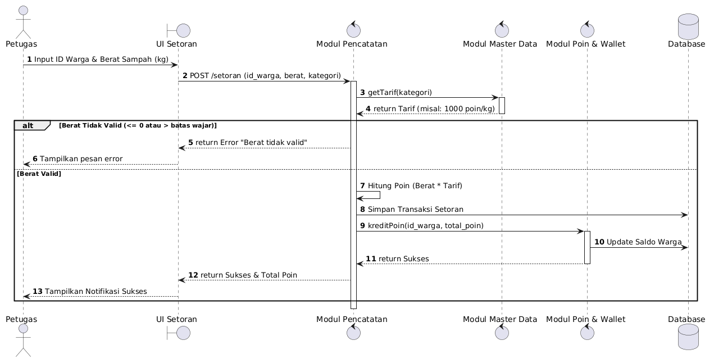

# Skenario 1: Input Setoran Sampah

## Penjelasan Skenario
Skenario ini merupakan alur paling krusial dalam aplikasi karena menjadi jantung operasional di mana sampah fisik yang disetor oleh warga dikonversi menjadi poin digital. Diagram ini memastikan bahwa pencatatan berat oleh Petugas, penarikan tarif dari Master Data, hingga penambahan saldo ke dompet warga (Wallet) terjadi secara akurat, berurutan, dan terhindar dari *human error*.

---

## Diagram Sequence

