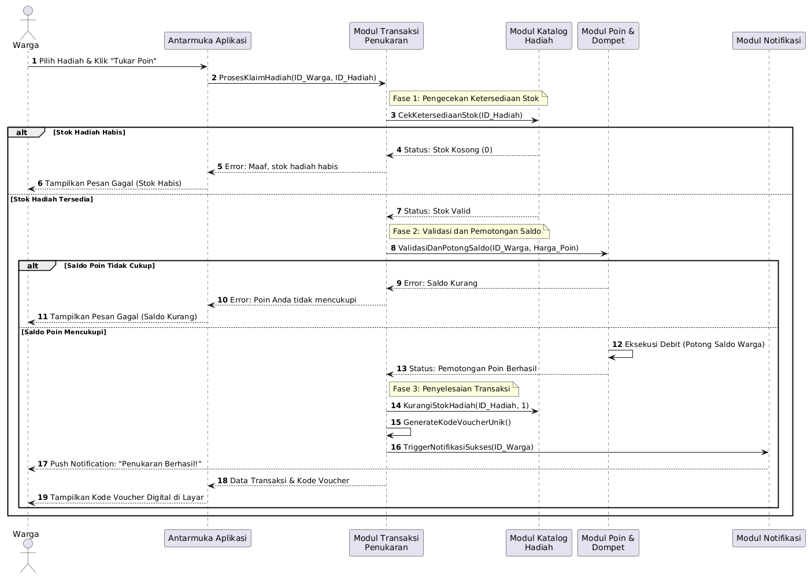

# Skenario 2: Input Reward setelah penyetoran sampah

## Penjelasan Skenario
Skenario ini merepresentasikan daya tarik utama aplikasi sekaligus puncak dari ekosistem ekonomi sirkular, di mana warga menukarkan tabungan poin mereka menjadi hadiah yang bernilai. Diagram ini memastikan bahwa proses pengecekan ketersediaan stok di Katalog Hadiah, validasi kecukupan poin di Dompet Warga (Wallet), hingga pemotongan saldo (debit) berjalan secara ketat dan atomik, sehingga sistem terhindar dari risiko saldo minus (negative balance) atau klaim hadiah fiktif.
---

## Diagram Sequence

