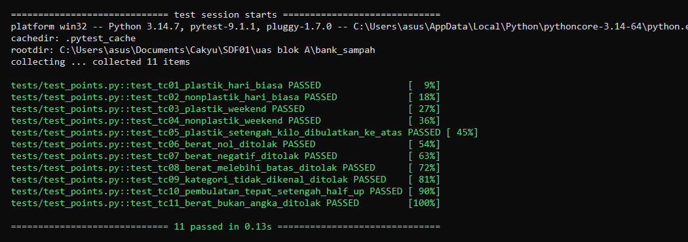

# D7. Unit-Tested Code — `calculate_points`

Fungsi yang dipilih: **`calculate_points(waste_type, weight_kg, on_weekend=False)`** di [`src/points.py`](../../src/points.py).

Fungsi ini dipilih karena menjadi inti skenario 1 (Input Setoran Sampah): setiap setoran warga berujung pada konversi berat sampah menjadi poin. Salah hitung di sini langsung merugikan warga (poin kurang) atau bank sampah (poin berlebih), dan kesalahan seperti itu tidak terlihat secara kasat mata di buku besar.

## Aturan perhitungan

| Kategori | Hari kerja | Akhir pekan |
| :--- | :--- | :--- |
| Plastik | 3 poin/kg | 6 poin/kg |
| Nonplastik | 2 poin/kg | 4 poin/kg |

- Pembulatan **half-up** ke integer (`2,5` → `3`, bukan `2` seperti `round()` bawaan Python).
- Berat wajib angka, `> 0`, dan `<= 100` kg. Di luar itu `ValueError`.
- Kategori di luar tabel tarif → `ValueError`.
- `on_weekend` adalah parameter, bukan tanggal sistem, agar perilaku akhir pekan bisa diuji secara deterministik.

## Pemetaan D6 → unit test

Semua 11 test case di [D6](../D6-Test-Case-Design.md) punya pasangan test dengan ID yang sama.

| ID | Skenario | Nama test | Jenis |
| :--- | :--- | :--- | :--- |
| TC-01 | Plastik 2,45 kg hari kerja → 7 poin | `test_tc01_plastik_hari_biasa` | Common |
| TC-02 | Nonplastik 3 kg hari kerja → 6 poin | `test_tc02_nonplastik_hari_biasa` | Common |
| TC-03 | Plastik 1 kg akhir pekan → 6 poin | `test_tc03_plastik_weekend` | Common |
| TC-04 | Nonplastik 2,5 kg akhir pekan → 10 poin | `test_tc04_nonplastik_weekend` | Common |
| TC-05 | Plastik 0,5 kg → 1,5 dibulatkan ke 2 | `test_tc05_plastik_setengah_kilo_dibulatkan_ke_atas` | Common |
| TC-06 | Berat 0 ditolak | `test_tc06_berat_nol_ditolak` | Edge |
| TC-07 | Berat negatif ditolak | `test_tc07_berat_negatif_ditolak` | Edge |
| TC-08 | Berat 150 kg (di atas batas) ditolak | `test_tc08_berat_melebihi_batas_ditolak` | Edge |
| TC-09 | Kategori "Kaca" ditolak | `test_tc09_kategori_tidak_dikenal_ditolak` | Edge |
| TC-10 | Nonplastik 1,25 kg → 2,5 dibulatkan half-up ke 3 | `test_tc10_pembulatan_tepat_setengah_half_up` | Edge |
| TC-11 | Berat "dua" (teks) ditolak | `test_tc11_berat_bukan_angka_ditolak` | Edge |

## Cara menjalankan test

```bash
pip install pytest
python -m pytest
```

Hasil: **11 passed**. Output lengkap ada di [`img/pytest-output.txt`](img/pytest-output.txt).

## Bukti test lulus


